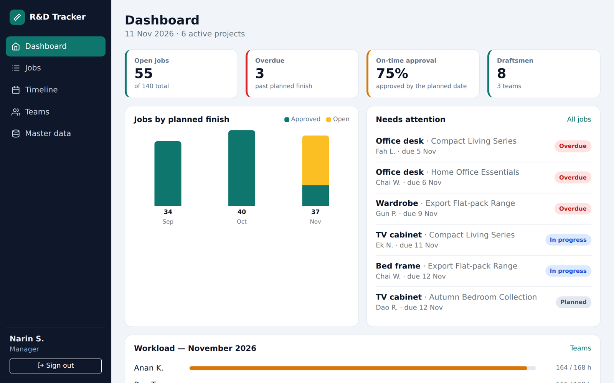
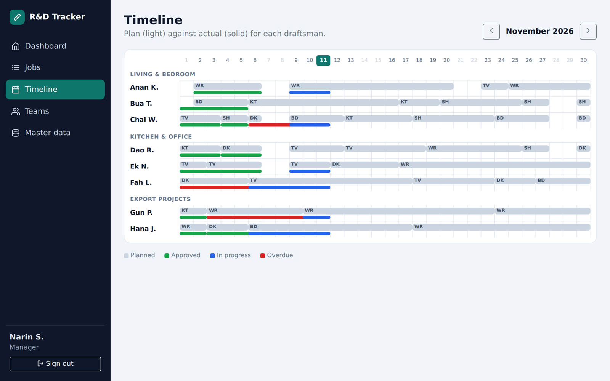
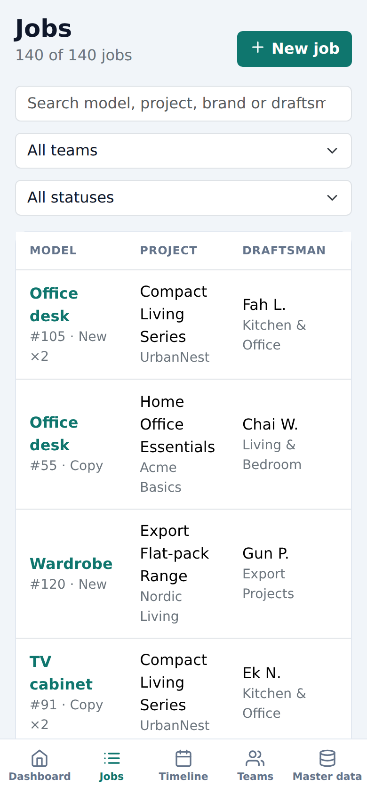
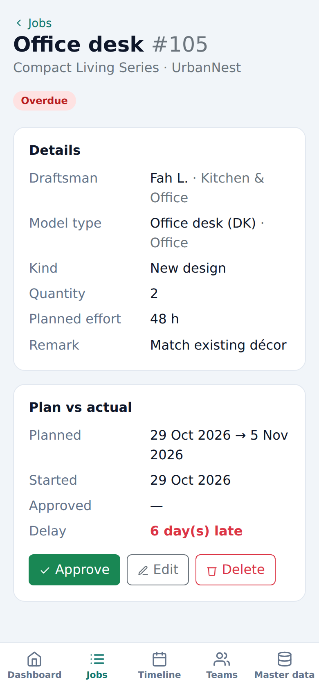
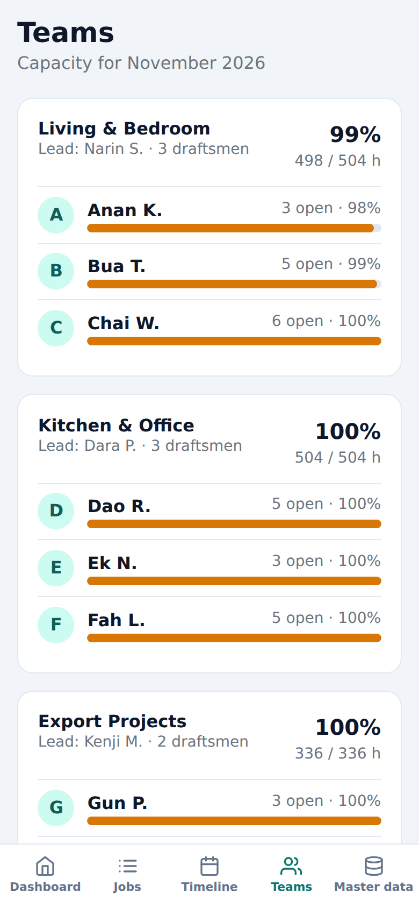
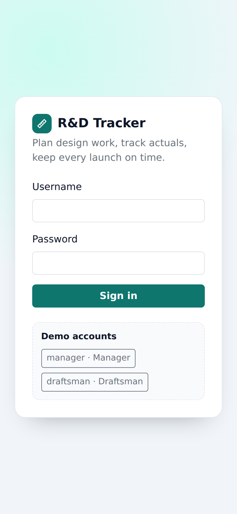
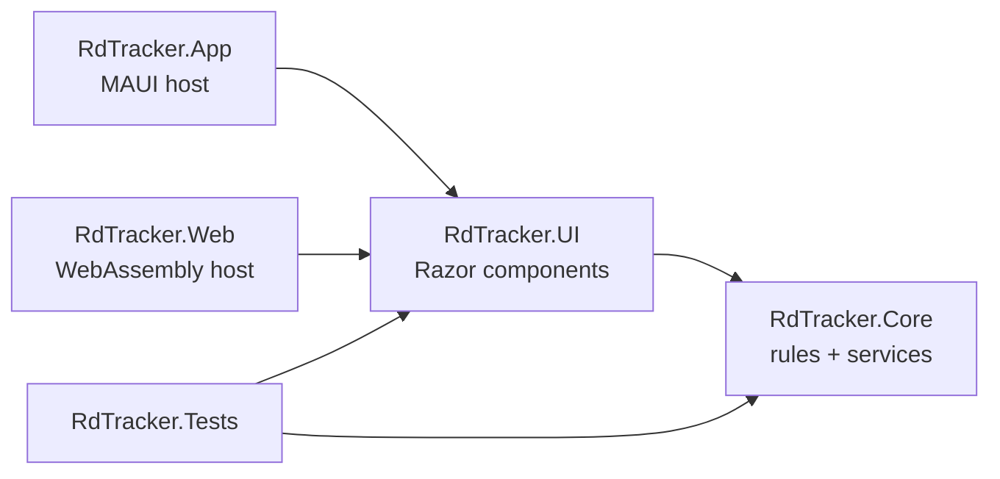

# R&D Tracker

[](https://github.com/Phanchai/Application_dotnetMuai/actions/workflows/ci.yml)


A planning and tracking app for a furniture R&D drawing office: who is designing
which model, how many hours it should take, and whether it was approved on time.

One set of Razor components runs as a **native Android / iOS / Windows / macOS app**
(.NET MAUI Blazor Hybrid) and as a **website** (Blazor WebAssembly).

> 🇹🇭 แอปวางแผนและติดตามงานเขียนแบบของแผนก R&D โรงงานเฟอร์นิเจอร์ — ใครเขียนแบบรุ่นไหน
> ใช้กี่ชั่วโมงตามมาตรฐาน และอนุมัติทันกำหนดหรือไม่ โค้ดหน้าจอชุดเดียวใช้ได้ทั้งแอปมือถือ (MAUI)
> และเว็บ (WebAssembly) ข้อมูลทั้งหมดเป็นข้อมูลสมมติของบริษัท Acme Panel Co.

| Dashboard | Timeline |
| --- | --- |
|  |  |

| Jobs | Job detail | Teams | Sign in |
| --- | --- | --- | --- |
|  |  |  |  |

## Features

- **Dashboard** — open and overdue jobs, on-time approval rate, jobs per month, and each draftsman's workload against capacity.
- **Jobs** — search and filter by team or status; plan a new job and let the app suggest the finish date from the model type's standard hours.
- **Workflow** — a draftsman starts their own job, a manager approves it; delay is counted in days past the planned finish.
- **Timeline** — a month view of plan (light bar) against actual (solid bar) for every draftsman.
- **Teams and master data** — teams, brands, and model types with their standard and copy hours.
- **Two roles** — managers plan, edit and approve; draftsmen can only start their own work.

## Try it

No backend or database is needed: the app ships with deterministic demo data that is
generated relative to today's date, so it always looks current.

| Username | Password | Role |
| --- | --- | --- |
| `manager` | `manager1234` | Manager — plan, edit, approve |
| `draftsman` | `draftsman1234` | Draftsman — start own jobs |

```bash
# Website (any OS, needs the .NET 10 SDK)
dotnet run --project src/RdTracker.Web

# Android app
dotnet workload install maui-android
dotnet build src/RdTracker.App -f net10.0-android -t:Run

# Tests
dotnet test tests/RdTracker.Tests
```

## Architecture

```
src/
  RdTracker.Core   Domain model, planning rules, reports, data and auth services  (plain .NET, no UI)
  RdTracker.UI     Razor class library: every page, component and the stylesheet
  RdTracker.App    .NET MAUI Blazor Hybrid host (Android, iOS, macOS, Windows)
  RdTracker.Web    Blazor WebAssembly host (the online demo)
tests/
  RdTracker.Tests  xUnit + bUnit
```



Design decisions:

- **Hosts are thin.** Each host is a few lines that call `AddRdTracker()` and mount `Routes`; nothing else is duplicated between mobile and web.
- **Business rules live in `Core` and are pure.** Working-day arithmetic (`WorkCalendar`), status and delay (`JobMetrics`) and the dashboard figures (`Reports`) take "today" as a parameter, so they are tested without mocks.
- **One data seam.** Pages depend on `IRdDataService`. The demo uses an in-memory store that enforces the same validation a server would; a REST client can replace it without touching the UI.
- **No charting or icon packages.** The bar chart, workload meters and timeline are plain HTML and CSS; icons are inline SVG.

## Quality

- 32 tests: planning rules, data-store validation, demo-data integrity, permissions, and component tests for sign-in and job filtering.
- GitHub Actions runs the tests, publishes the WebAssembly site and builds the Android app on every push.

## About this repository

This is a portfolio remake of an internal tool I originally built for a furniture
manufacturer. It has been rewritten on .NET 10 with a new structure, tests and CI.
Every name, brand, account and number in it is fictional sample data.

## License

[MIT](LICENSE)
